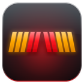
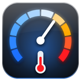
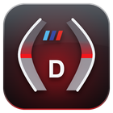

# iDrive 7 apps

BMW iDrive 7 (MGU) apps as a source for the [mgu-store](https://github.com/robertnisipeanu/mgu-store). One
repo, many apps: each app is a folder under `apps/`, and the Store lists every one of them. Adding an app
needs no change to `mgu-repo.json`.

## Apps

| App | What it does | Docs |
|---|---|---|
|  Shift Lights (`adam_shiftlights`) | RPM shift lights on the instrument cluster and the HUD, per-drive-mode thresholds, cold-engine limit | [apps/adam_shiftlights](apps/adam_shiftlights/README.md) |
|  Engine Vitals (`adam_vitals`) | Boost, power, torque, gear, oil, coolant and transmission temperatures with a warm-up takeover until they reach operating temperature (220 / 220 / 160 °F) and a turbo cool-down tab; Thermals, Fuel & ignition, Chassis from M Vitals | [apps/adam_vitals](apps/adam_vitals/README.md) |
|  M Track Cluster (`adam_mtrack`) | An M Track style cover over the instrument cluster in Sport+: bar tachs to 7,000 rpm, gear over mph, side panels, corner gauges, shift slats. Off by default; drops at once on any guard; a Safety tab with every guard, its state, the signals it reads, what the cluster renderer says and which build stage the cover reached, and a parked test pattern (G's Dash's known-good shape first); 4 layers, 2.9 MiB of the renderer's memory; an emulator view to try it without the car | [apps/adam_mtrack](apps/adam_mtrack/README.md) |

## Status

Each app's README says what has run on a car so far. Read each app's Safety section before you install it.

## Install an app

1. Install the Store's own prerequisites first: the app's README lists the tools it needs (for example the
   **cluster-render** tool from `robertnisipeanu/idrive-apps` for Shift Lights). The Store installs the GPU
   renderer and the controller gate from the upstream `cauliflowermossgrape/idrive7-apps` source (one of its
   default sources) together with each app here. The controller gate loads into the HMI at the next
   head-unit start.
2. In the Store: Settings, **Add source**, type `pinguinooo/idrive7-apps`, OK. If the repo's page opens,
   pick **Branch main**. Or type `github.com/pinguinooo/idrive7-apps/tree/main` to add it on main directly.
3. Pick the app in the Store, Install. The head unit builds it from this source with its own oap-sdk.

Updates follow the `main` branch.

## Safety, for every app

- Never kill an app or MainApp by hand: the car counts a hand kill as a crash. Restart only from the Store,
  at most once.
- Never reinstall an app that crashed. Remove it with the Store.
- Each app documents its own kill switches. Every callback in an app must go through a guard that catches
  errors ([docs/ADDING-AN-APP.md](docs/ADDING-AN-APP.md), "Crash-loop safety").

## Adding an app

Copy `apps/_template` to `apps/<new_id>`, edit `app.json`, replace the icon, write the app. The Store, the
syntax check and the tests find it by listing `apps/`. Steps, rules and testing:
[docs/ADDING-AN-APP.md](docs/ADDING-AN-APP.md).

## Layout

| Path | What |
|---|---|
| `apps/<id>/` | one app: `app.json`, `main.js`, `icon.png`, its modules and its README. `apps/_template` is the skeleton the Store ignores |
| `test/` | `run.js` (the runner), `apps.test.js` (checks every app folder), `test/<id>/` (one app's own tests) |
| `tools/check.sh` | the self-check: Node 8 syntax of the kit and every app, then all tests |
| `tools/car-logs.sh` | read-only evidence from the car (cluster-render's status and log, the apps' logs and settings) into a folder and a .tar.gz; changes nothing on the car |
| `kit/` | the build kit from upstream idrive7-apps, with one added line in `kit/tools/build.py` (an app.json `"mguAppStartType"` goes to the package's `package.json`) |
| `mgu-repo.json` | what the Store reads: `apps/*` is discovered, `exclude` lists folders it skips, `requires` the tools every app needs |
| `docs/` | how to add an app |

## For developers

- Self-check (Node 8 is what the car runs): `NODE=/path/to/node8 tools/check.sh`. It runs per app: Node 8
  syntax check of `apps/<id>/*.js`, the pinned cluster-render client where an app has one, then every test.
- Build like the head unit does: put an `oap-sdk/` (index.js and package.json, made from your own car's donor
  with upstream idrive7-apps' `kit/tools/extract_sdk.js`) at the repo root, then
  `python3 kit/tools/build.py <id>` (no id builds every folder with an `app.json`, `_template` included). The
  package lands in `dist/`. Never commit `oap-sdk/` or a built package.
- Don't publish GitHub Releases or tags unless they carry packages. The Store reads this repo as a repo tree
  on its branch.

## Licences

The apps' own code is MIT (`LICENSE`). `kit/` is part of
[idrive7-apps](https://github.com/cauliflowermossgrape/idrive7-apps), MIT (`kit/LICENSE`, `kit/NOTICE`), unmodified
but for one line in `kit/tools/build.py` that copies app.json's `"mguAppStartType"` into `package.json`.
Third-party files inside an app carry their own notice in that app's folder (for example
`apps/adam_shiftlights/NOTICE`). No BMW code or SDK is in this repo.
