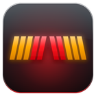
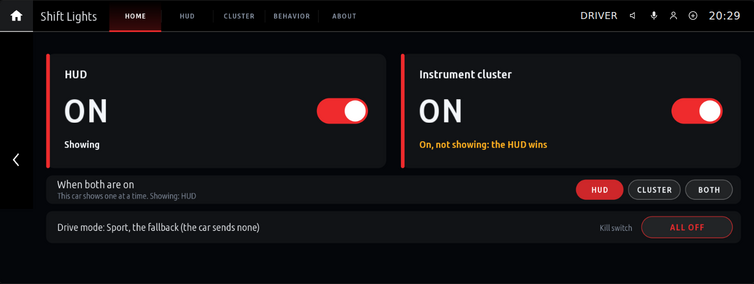
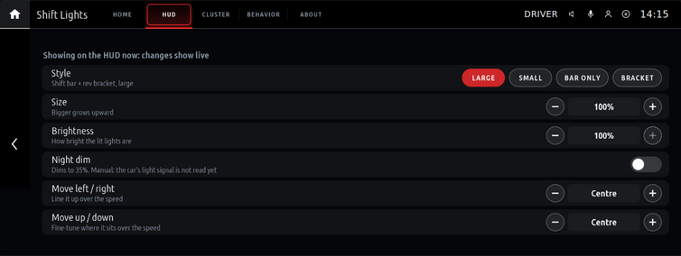
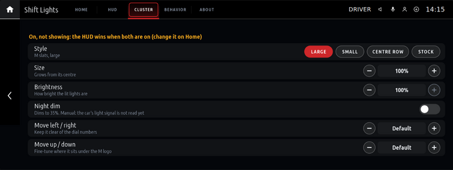
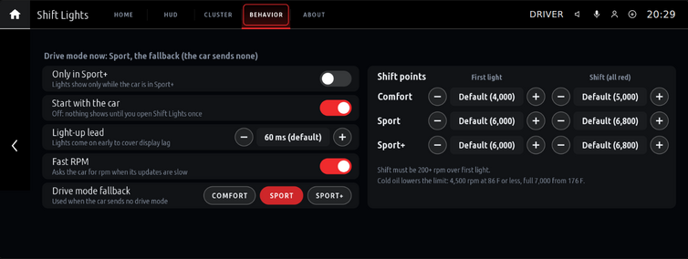
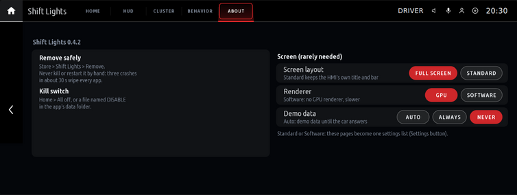
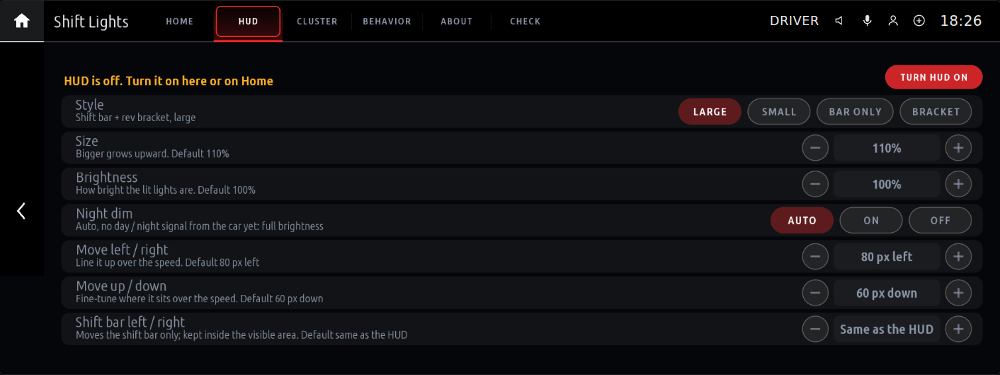
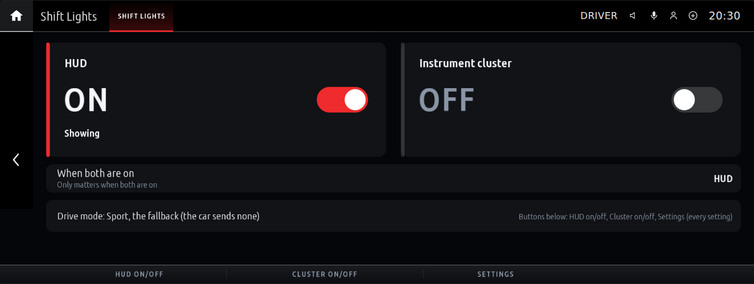

# Shift Lights for iDrive 7

RPM shift lights for BMW iDrive 7 (MGU) on the instrument cluster and the HUD, as an app for the
[mgu-store](https://github.com/robertnisipeanu/mgu-store). OEM-style M slats light up from the outside in,
amber then red, with their own thresholds per drive mode and a lower limit while the engine is cold.
The centre screen holds the settings on five pages (Home, HUD, Cluster, Behavior, About). It draws only when
something changes: there is no live preview, so nothing on that screen competes with the rpm updates.

## Status

**Untested on a real car.** So far it has only run in the upstream idrive7-apps emulator, against a fake
cluster-render service, and in Node 8 unit tests. 0.4.0's settings pages are proven in the emulator only. Read the
Safety section before you install it.

## Requirements

- An iDrive 7 head unit with the mgu-store installed.
- The **cluster-render** tool from `robertnisipeanu/idrive-apps` (Store, Cluster renderer). Install it
  first: the app draws on the cluster and the HUD through it. Without it the app runs, but nothing reaches
  the cluster or the HUD.
- The upstream idrive7-apps source, `cauliflowermossgrape/idrive7-apps` (one of the Store's default sources). The Store installs its GPU renderer and
  controller gate with this app. The controller gate loads into the HMI at the next head-unit start.

## Install

1. In the Store: Settings, **Add source**, type `pinguinooo/idrive7-apps`, OK (the [repo README](../../README.md) has the same steps for every app here).
2. If the repo's page opens, pick **Branch main**. Or type `github.com/pinguinooo/idrive7-apps/tree/main`
   in step 1 to add it on main directly.
3. In the Store: Shift Lights, Install. The head unit builds the app from this source with its own oap-sdk.

Updates follow the `main` branch.

## Settings

Header tabs across the top; turn the knob along the tabs, press to open one, then on down the page (or tap).
Every page fits one screen. The pill in colour is the value in use; a greyed row says why on its page.

| Page | Setting | Values | Default |
|---|---|---|---|
| Home | HUD | on / off (big card) | off |
| Home | Instrument cluster | on / off (big card) | off |
| Home | When both are on | HUD, Cluster, Both (experimental centre area) | HUD |
| Home | All off | turns both off (the kill switch) | |
| HUD | Style | Large, Small (shift bar + rev bracket), Bar only, Bracket (rev bracket + gear) | Large |
| HUD | Size | 70 to 120 % | 110 % |
| HUD | Brightness | 20 to 100 % | 100 % |
| HUD | Night dim | on / off | off |
| HUD | Move left / right | 100 px left to 100 px right, steps of 10 | 80 px left |
| HUD | Move up / down | 60 px up to 60 px down, steps of 10 | 60 px down |
| HUD | Shift bar left / right | 100 px left to 100 px right of the HUD, steps of 5 (Large and Bar only) | 70 px right |
| Cluster | Style | Large, Small (M slats), Centre row (12 lights), Stock (one block per dial) | Large |
| Cluster | Size, Brightness, Night dim | as on the HUD page | |
| Cluster | Move left / right | 50 px left to 50 px right, steps of 5 | Default |
| Cluster | Move up / down | 40 px up to 40 px down, steps of 5 | Default |
| Behavior | Only in Sport+ | on / off | off |
| Behavior | Start with the car | on / off | on |
| Behavior | Light-up lead | Off, 20 to 150 ms | 60 ms |
| Behavior | Fast RPM | on / off | on |
| Behavior | Drive mode fallback | Comfort, Sport, Sport+ | Sport |
| Behavior | Shift points: first light, per mode | Default, 2,000 to 6,500 rpm | Default |
| Behavior | Shift points: shift (all red), per mode | Default, 2,500 to 6,800 rpm, steps of 100 | Default |
| About | Screen layout | Full screen, Standard | Full screen |
| About | Renderer | GPU, Software | GPU |
| About | Demo data | Auto, Always, Never | Auto |

With the Software renderer, the Standard layout or no touch routing, the screen shows a read-only Home and the
bar's three buttons: HUD on/off, Cluster on/off and Settings, which opens the HMI's own list of every setting
(in the same order as the pages).

A new install starts with both displays off. Settings saved by 0.2.x move over on the first start: a display
that was showing stays on. 0.4.0 keeps every saved setting as it was (and so does 0.4.1: it only adds the Shift bar move, and its start values for fresh installs).

"Default" uses the built-in thresholds for that mode.

### HUD and cluster together

The car shows the cluster panel and the HUD from one scene, so only one of them at a time. With both on,
"When both are on" (Home) picks the one you get: the HUD (default) or the instrument cluster. Home says which
one is showing and that the other is on but not showing. The third choice, HUD plus the
lights in the cluster's centre area, is experimental: on a G01 in the M layout that area showed nothing.

### Drive mode and Only in Sport+

The app reads the car's drive mode (Driving Experience Control). The per-mode thresholds follow it, and "Only
in Sport+" shows the lights only while the car is in Sport+. When the car sends no drive mode, "Drive mode
fallback" is used, and the Behavior page says "the fallback (the car sends none)".

### Start with the car

The app starts with the car (it is installed as an autostart app). With this setting off, it still starts,
but sends nothing to the cluster or the HUD until you open its screen once.

### Cluster position

Since 0.3.1 the cluster bar sits 25 px lower than in 0.3.0 (the M slats' top edge at y 134 of the 1920 x 720
panel, was 109). The Cluster page's Move settings shift it from there in 5 px steps; a move that would put the bar off the
panel falls back to the default place. Keep it clear of the dial numerals either side.

### Lead and Fast RPM

The car sends the engine speed only when it changes, and not very often, so the lights trail the real rpm by up
to one update. Two settings close that gap:

- **Light-up lead** lights each light that much earlier while the rpm climbs (from the slope of the last
  150 ms; nothing when the rpm is steady, falls, or climbs under 1,000 rpm/s). Lights go out a little later by
  the same amount, so they don't flicker. Off gives 0.3.0's behaviour.
- **Fast RPM** asks the car for the rpm (its getter) when no update came for 40 ms: at most 25 times a second,
  one request at a time, backing off to once every 2 s if the car doesn't answer.

### HUD position

The defaults (0.4.1) are the values tuned on the car: 110 %, 80 px left, 60 px down, which lines the art up with the stock
mph. Only a fresh install starts there; saved values are never changed.

The shift bar is wide (578 px at 100 %, 636 at 110 %), and the HUD shows a picture of at most 680 x 300 px inside its
800 x 480 scene (wider is cut off). With the HUD moved 80 px left the bar's left end sat at x 2, outside that box. The bar
now has its own Shift bar left / right move on top of the HUD move (default +70 px: the smallest 5 px step that keeps its
left end 8 px inside the box), and it is always held inside the box left and right, whatever the settings (the HUD page
says so when it did). Too wide for the box (120 %): centred. The box is assumed centred in the scene and has not been
measured on the car (`hud.visible` in config.js). Up / down is not clamped.

The gear spot shows 1 to 9 in D, and P, R or N from the selector; a value it does not know shows nothing.

The HUD art is centred on the stock speed. The HUD page's Move settings shift it if it sits off centre on your car; a bigger
size grows upward, away from the speed. The app draws no speed or unit: the stock HUD shows those.

## Screens

From the idrive7-apps emulator (the 1920 x 720 centre screen, scaled down). Not yet seen on the car's own screen.

| Home | HUD | Cluster |
|---|---|---|
|  |  |  |
| **Behavior** | **About** | **HUD off** |
|  |  |  |
| **Read-only Home** (no touch routing) | | |
|  | | |

## Safety

- Kill switches, fastest first: **All off** on Home (or turn **HUD** and **Instrument cluster** off), a
  file named `DISABLE` in the app's data folder (its path is in the log line `kill switch file:`), or Remove
  in the Store.
- Never kill the app or MainApp by hand. The car counts a hand kill as a crash. Restart it only from the
  Store, and at most once.
- Never reinstall an app that crashed. Remove it with the Store.
- The app stops all cluster and HUD output after 5 errors in 10 seconds. Turn a display off and on to reset
  that. Demo data never reaches the cluster or the HUD.

## Latency

Measured on claudius-vm under Node 8 with `test/adam_shiftlights/latency_trace.js` (the real main.js and kit
car.js against a fake car and a fake cluster-render, 5 pulls at 3000 rpm/s; the getter is the best case):

- The app's own delay from an rpm update to the cluster-render message is about 0.2 ms (p50) in every mode.
- 0.4.0 dropped the preview, and with it all drawing while you drive. With the app screen open (20 updates a
  second, lead 60, Fast RPM on): 0.3.1's 10 fps software preview cost 15 ms a frame (max 57) and held the event
  loop up to 56 ms (p99 30), so an rpm update could wait that long; 0.4.0: 1.8 ms (p99 1.3), the same as with the
  screen closed. On the GPU path 0.3.1 ran its frame callback 838 times in the 13 s run (4 ms at most); 0.4.0
  runs none. Own delay max: 0.8 ms (0.3.1, software) vs 0.3 ms (0.4.0).
- What the driver sees is set by the car's update rate: with no lead, 47 ms (p50) behind the rpm at 10 updates
  a second, 22 ms at 20. Fast RPM with a fresh getter: 19 and 15 ms. Lead 60: about 40 ms early at the socket,
  which leaves room for the cluster's own flush and refresh (not measured here).
- Re-run: `node --expose-gc test/adam_shiftlights/latency_trace.js --hz 20 --lead 60 --poll on --preview software`
  (`--app <older checkout>/apps/adam_shiftlights` for a before run).

## For developers

- Self-check from the repo root (Node 8 is what the car runs): `NODE=/path/to/node8 tools/check.sh`. It syntax-checks every app
  and the kit, checks the cluster-render client against its pinned commit, then runs the unit tests (this app's are in
  `test/adam_shiftlights/`).
- Build like the head unit does: put an `oap-sdk/` (index.js and package.json, made from your own car's
  donor with upstream idrive7-apps' `kit/tools/extract_sdk.js`) at the repo root, then
  `python3 kit/tools/build.py adam_shiftlights`. The package lands in `dist/`. Never commit `oap-sdk/` or a
  built package.
- Icon: `python3 kit/tools/render_icons.py --tile adam_shiftlights` (needs Pillow and headless Chromium)
  renders `kit/icons/adam_shiftlights.svg` to `apps/adam_shiftlights/icon.png`.
- The emulator and shader tests live in the private working repo, not here.
- Don't publish GitHub Releases or tags unless they carry packages. The Store reads this repo as a repo
  tree on its branch.

## Licences

The app's own code is MIT (`LICENSE`). `kit/` is part of
[idrive7-apps](https://github.com/cauliflowermossgrape/idrive7-apps), MIT (`kit/LICENSE`, `kit/NOTICE`), unmodified
but for one line in `kit/tools/build.py` that copies app.json's `"mguAppStartType"` into `package.json`.
`apps/adam_shiftlights/cluster_render_client.js` is from
[idrive-apps](https://github.com/robertnisipeanu/idrive-apps), MPL-2.0 (`apps/adam_shiftlights/NOTICE`).
No BMW code or SDK is in this repo.
