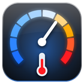

# Engine Vitals for iDrive 7

M Vitals and Warm-Up in one app for BMW iDrive 7 (MGU), for the
[mgu-store](https://github.com/robertnisipeanu/mgu-store). The Main page shows boost, power, torque, the gear,
oil and coolant in M Vitals' style. While the engine is still cold, the warm-up view (time to ready, safe rev
limit, trend) takes Main's place until you hide it or the engine warms up. A Cool down page tells you whether
to idle or keep driving gently after hard driving, so you don't park with a hot turbo.

Adapted from upstream idrive7-apps `apps/car_vitals` 2.25.0 and `apps/warmup` 1.7.3 (MIT, see `NOTICE`).
Built for a 2024 X3 M40i (G01 LCI, B58).

## Status

**Untested on a real car.** So far it has only run in the upstream idrive7-apps emulator (manual and demo
signals) and in Node 8 unit tests. What only the car can prove:

- Boost and the power % from the sport display (FES) on a G01 LCI. Without them boost comes from the engine
  unit (OBD) and power shows as "Power (torque x rpm)".
- The engine unit DIDs (boost, fuel pressures, timing, misfires) answering on this B58.
- The gear and D / S / M signals, and the tyre values in the car's units.
- The seven tabs fitting the real header, and Hide warm-up working from the controller.
- Max power: the default 285 kW (382 hp) is the 2024 X3 M40i's published figure [U] (third-party spec pages,
  e.g. https://www.cars.com/research/bmw-x3-2024/specs/443367; not checked against BMW USA). Change it in
  Settings for a tuned car.

## Pages

| Tab | What |
|---|---|
| Main | Boost (psi, -10 to 30), power, torque, gear, oil and coolant. No rpm or speed. The gear card's left side says READY, WARMING ~N min, COOL-DOWN N s or OK TO SHUT OFF. |
| Thermals | Coolant, engine oil, gearbox oil, gearbox (EGS), ambient with 5-minute traces (M Vitals) |
| Fuel & ign. | Intake air, fuel pressures, timing, boost and air charge target vs actual, misfires (M Vitals, from the engine unit) |
| Chassis | G-force circle, tyres, xDrive split (M Vitals) |
| Warm-up | Oil and coolant gauges, time to ready, safe rev limit, 20-minute trend (Warm-Up) |
| Cool down | Turbo cool-down advice with a countdown, oil and coolant over the last 10 minutes, a boost strip |
| Settings | Added by the kit |

## Warm-up takeover

- Main shows the warm-up view while the oil or the coolant is under its "is warm at" setting (80 °C / 176 °F by
  default) and the engine hasn't been warm yet this drive.
- **Hide warm-up** (on the page, or the bar button) shows the vitals for the rest of the drive.
- Once both are warm it goes for the drive, even if a temperature dips later.
- A new drive is the engine off for 10 minutes then running again, or the app starting again (the head unit
  sleeps after you lock the car). A start-stop stop at a light is not a new drive.
- Setting **Show warm-up screen when cold** off: never.

## Units

**Units**: US (psi, °F, hp, lb-ft; the default), Metric (bar, °C, kW, Nm), or Follow the car's display units.
US or Metric always beats what the car says. Values are kept in °C, bar, kW and Nm and converted where drawn.
The threshold settings show both units ("176 °F (80 °C)", "382 hp (285 kW)").

## Measured or estimated

| Value | Where it comes from |
|---|---|
| Oil temperature | Measured: the car's CDS signal. With nothing from it for 15 s, the engine unit over OBD (also measured; the label then says "engine unit"). |
| Coolant | Measured (CDS) |
| Boost | Measured: the sport display (FES), else the engine unit's charge pressure minus outside pressure |
| Torque | Measured (FES, crankshaft torque) |
| Power | The sport display's % x Max power; **estimated** from torque x rpm when the car sends no %, labelled so |
| Gear | The gearbox signal; **estimated** from rpm / speed when it's missing (EST.) |
| Minutes to warm | **Estimate**: typical rates blended with the measured rate over the first 2 min (EST.), then measured |
| Safe rev limit | Rule of thumb (Warm-Up's): the cold limit at 30 °C oil rising to the redline at "oil is warm at" |
| Cool-down time | **Estimate** from recent load (rpm, power, boost), not a turbo temperature sensor |

## Cool-down thresholds

| Name | Value | Where from |
|---|---|---|
| Hard use | over 3800 rpm or 90 kW (121 hp) | Warm-Up 1.7.3 |
| Hard use by boost | over 0.8 bar (11.6 psi) | new here [U] |
| Gentle (counts down) | under 2800 rpm and 40 kW (54 hp), engine running | Warm-Up 1.7.3 |
| Hard use before it asks | 8 s | Warm-Up 1.7.3 |
| Cool-down asked | 30 s + 3 s per hard second, 30 to 180 s | Warm-Up 1.7.3 |
| Short bursts fade | at 0.2 s per second without a cool-down | Warm-Up 1.7.3 |
| "Cooled" shown for | 20 s | Warm-Up 1.7.3 |
| Stopped (idle advice) | under 5 km/h (3 mph) | new here |
| Engine off | doesn't count down; off 15 min clears it | new here [U] |

Sources: I found no BMW wording for the B58 or the X3 G01 on cooling a turbo before switching off, so "no
forced idle needed after normal driving" is [U]. Other makers' manuals ask for about a minute of idling after
high speed or heavy load, e.g. Kia: https://ownersmanual.kia.com/full_webhelp/MQ4A/2026/en_US/topics/t00377.html
(not BMW's guidance). The 30 to 180 s range is Warm-Up's.

## Settings

Units, Start page, Show warm-up screen when cold, Oil is warm at, Coolant is warm at, Turbo cool-down
guidance, Oil temp warning, Rev limit when cold, Redline, Max power, then M Vitals' own: Power from, Boost from,
Engine, peaks, xDrive card, the Auto / Show / Hide of each value, theme, layout, renderer, demo data.
A bad saved value goes back to its default once, with a line in the log.

## Safety

- It reads only. The only active traffic is M Vitals' read-only engine unit poll (UDS 22, OBD 01 / 06).
  Nothing goes to the cluster or the HUD.
- Kill switches, fastest first: a `DISABLE` file in the app's data folder (`<dataDir>/DISABLE`, its path is in
  the log at start) stops the engine unit reads within 2 s, and the screen says so; Remove in the Store.
- Every callback is guarded: an error is logged and counted, never thrown. 5 errors in 10 s stop the engine
  unit reads (the screen says STOPPED) until the app starts again.
- Missing signals show `--` or a line saying why.
- Never restart or kill the app or MainApp by hand on the car, and never reinstall an app that crashed:
  remove it with the Store.

## Install

1. In the Store: Settings, **Add source**, type `pinguinooo/idrive7-apps`, OK (skip if it's already there;
   the Store refreshes the source and lists new apps by itself).
2. In the Store: Engine Vitals, Install.
3. Open it once with the engine cold to see the warm-up view, then Hide.
